<a href="https://chickenwings.in">
<picture>
  <source media="(prefers-color-scheme: dark)" srcset="assets/terrain-dark.svg">
  <source media="(prefers-color-scheme: light)" srcset="assets/terrain-light.svg">
  
</picture>
</a>

**Start at [chickenwings.in](https://chickenwings.in)**: everything I'm building, in one place. Also on [LinkedIn](https://www.linkedin.com/in/aksh-rastogi-108a41380/) · [Résumé](https://chickenwings.in/resume/)

### Projects

- **[VihPluh](https://github.com/ChickenWings-0/vihpluh)**: a fast, keyboard-driven desktop media player, mpv's playback engine under a compact, modern interface.
- **[MAITRI](https://maitri.cc)**: an adaptive AI wellness companion that reads mood, voice, posture and heart rate. I'm co-founder & CTO. [maitri.cc](https://maitri.cc)
- **[SatQuery AI](https://github.com/ChickenWings-0/SatQuery-AI)**: an agentic vision-language assistant for satellite imagery, with optical/SAR fusion, change reasoning and text-guided grounding.
- **[JOC](https://github.com/Bhavya2007-18/JOC)**: a real-time system monitoring and optimisation engine.
- **[RoomSync](https://github.com/ChickenWings-0/RoomSync)**: syncs Bluetooth LE room lights to what's on the screen and playing through the speakers.
- **[Circuit Debugger: Find the Fault](https://circuitdebugger-findthefault.vercel.app)**: simulate digital logic circuits, inject faults and track them down, as a game or by automatic test-vector diagnosis. [circuitdebugger-findthefault.vercel.app](https://circuitdebugger-findthefault.vercel.app)
- **[Smart Energy Consumption Prediction & Analysis](https://pbl-iota.vercel.app)**: numerical methods on smart-meter data: fills in lost readings, works out energy use and the bill, and finds when the load crosses its limits. [pbl-iota.vercel.app](https://pbl-iota.vercel.app)
- **[Expression Evaluator](https://github.com/ChickenWings-0/Expression-Evaluator)**: a stack ADT written from scratch in C++17 to check brackets and convert and evaluate infix, postfix and prefix expressions.
- **[Attendance Management System](https://oops-pbl.vercel.app)**: attendance for a school or college, written in C++ with a terminal version and a C++ web server behind a browser interface: marking by date and subject, percentages, a defaulter list and daily and monthly reports. [oops-pbl.vercel.app](https://oops-pbl.vercel.app)

The map behind my intro is my last 52 weeks on GitHub drawn as terrain: time runs west to east, each ridge is a repository and height is activity per week. Redrawn every Sunday.
